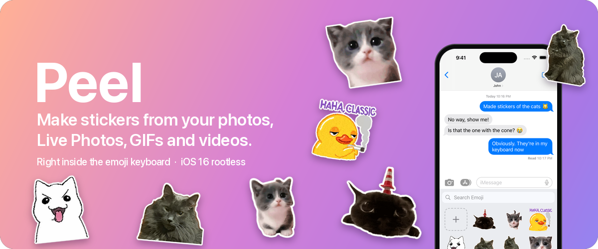
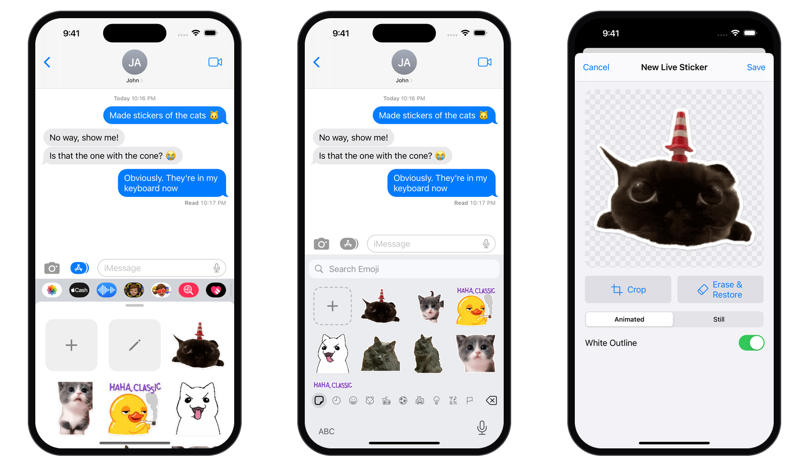
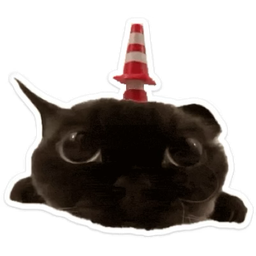
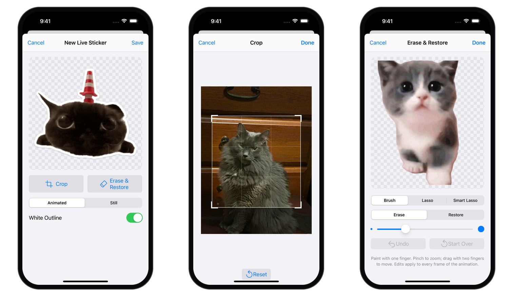
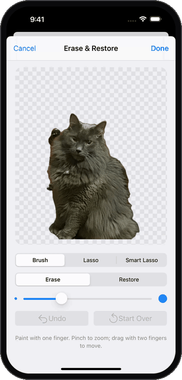

<p align="center">
  
</p>

<p align="center">
  
  
  
  
</p>

<p align="center">
  <a href="https://flameaway.github.io/repo/"></a>
</p>

<p align="center">
  <b>Peel brings iOS 17's Live Stickers to iOS 16.</b><br>
  Lift the subject out of any photo, Live Photo, GIF or video, give it a die-cut outline, and use it from the emoji keyboard in every app. In Messages you can peel it off and stick it onto a bubble.
</p>

---

<picture>
  <source media="(prefers-color-scheme: dark)" srcset="docs/images/showcase-dark.png">
  
</picture>

## Features



- **One-tap background removal.** Uses the same engine as Photos' "Copy Subject" (VisionKit), so you get the same clean cut-outs.
- **Animated stickers.** Live Photos, GIFs and videos become 30 fps animated stickers (HEICS, the format iOS 17 uses), and they still fit Messages' 500 KB limit.
- **Lives in the emoji keyboard.** A Stickers button sits in the emoji category bar in every app. Tap a sticker to insert it, or "+" to make a new one without leaving the app you're in.
- **Peel and stick.** In Messages, touch and hold a sticker to peel it off, then drop it on any bubble, just like Apple's stickers.
- **Fix the cut-out.** Crop, then use the Erase & Restore brush to clean up the edges, with pinch to zoom and undo.
- **Die-cut outline.** A white border with a soft shadow that you can switch on or off.
- **iMessage app included.** Your stickers also show in the Messages app drawer with native peel-and-drag. Tap the pencil tile there to delete stickers.
- **No home screen app.** Peel lives in Messages and the emoji keyboard; the app that hosts the iMessage app is hidden, like Messages-only App Store apps.

## The sticker maker



| Preview | Crop | Erase & Restore |
| --- | --- | --- |
| See the finished sticker, switch the outline on or off, and choose still or animated with the frame rate. | Frame the part of the photo or video you want. | Paint away leftover background or bring back parts the cut-out missed. |



### Cleaning up a cut-out

Background removal sometimes keeps a bit of the background that touches your subject. Here it kept two dresser drawer pulls next to the cat. In **Erase & Restore**, pinch to zoom in, paint over the extra bits with **Erase**, and they're gone. Turn the brush down for the last pass along the fur. **Restore** paints back anything the cut-out missed, and **Undo** steps back one stroke at a time.

For bigger areas, **Lasso** erases or restores everything inside the outline you draw, and **Smart Lasso** finds the object you draw around so you don't have to trace it.

<br clear="right">

The same maker is shared by the iMessage app and the keyboard, so both ways in work the same.

## Install

<p>
  <a href="https://flameaway.github.io/repo/"></a>
</p>

1. On your device, open **[flameaway.github.io/repo](https://flameaway.github.io/repo/)** and tap **Add to Sileo** or **Add to Zebra** (or add `https://flameaway.github.io/repo/` under Sources). You'll get updates automatically from then on.
2. Search for **Stickers** and install it, then respring.
3. In Messages, open **Stickers** in the app row and tap "+" to make your first sticker, or open any keyboard, switch to emoji, and tap the sticker icon at the bottom left.

You can also download the `.deb` from [Releases](../../releases) and install it with `dpkg -i`.

**Requirements:** a rootless jailbreak (tested on Dopamine, iPhone 14 Pro Max, iOS 16.5). Background removal needs an A12 chip or newer.

## What's in the package

| Part | What it does |
| --- | --- |
| `StickersApp` → `/var/jb/Applications/Stickers.app` | A stub that hosts the iMessage app. `LSApplicationLaunchProhibited` and `SBAppTags: hidden` keep it off the home screen. |
| `Shared/Creator` | The sticker maker used everywhere: crop the photo or video, background removal (the engine behind Photos' "Copy Subject"), an Erase & Restore brush to fix the cut-out, a white die-cut outline, and encoding to PNG or (animated) 30 fps HEICS within Messages' 500 KB limit. |
| `EmojiStickers` tweak | Adds a sticker button to the emoji keyboard's category bar in every app. Tap a sticker to insert it (in apps whose text field doesn't take pasted images, it's copied for you to paste); touch and hold to peel it off (with Messages' own peel animation), then drop it on a bubble in Messages to stick it there. "+" opens the sticker maker over the current app. |
| `CreatorLibrary` → `STKCreator.dylib` | The sticker maker for the keyboard. The tweak loads it only when "+" is tapped, so apps don't load Photos and AVFoundation just for showing the keyboard. |
| `MessagesExtension` (iMessage app) | Your stickers with Messages' native peel-and-drag, "+" to make one without leaving the conversation, and an Edit tile to delete them. |

Stickers are stored in `/var/jb/var/mobile/Library/Stickers`. Sandboxed apps such as Messages can read the jailbreak root on Dopamine, but not our app group container.

## Build

Requires [Theos](https://theos.dev) with `sdks/iPhoneOS16.5.sdk`.

```sh
make package FINALPACKAGE=1                                         # -> packages/com.flame.stickers_*_iphoneos-arm64.deb
make do FINALPACKAGE=1 THEOS_DEVICE_IP=<ip> THEOS_DEVICE_USER=root  # build, install, restart Stickers and Messages
```

`make install` on its own reinstalls the last built package without rebuilding.

## How it works

### Stickers on bubbles

When a sticker is dropped in Messages, the tweak calls ChatKit's own code path: `-[CKChatController sendSticker:withDragTarget:]` with an `IMSticker` and a `CKBrowserDragControllerTarget`. This is what Messages' sticker drawer calls when you drop a sticker. Each sticker is attributed to the bundled iMessage app's balloon plugin ID (`com.apple.messages.MSMessageExtensionBalloonPlugin:<team>:com.josh.stickers.messages`) and identified by its `.png`/`.gif` file name. Receiving devices don't show stickers without an app attribution, and Messages can't draw cached sticker files without an image file extension.

### Background removal

Background removal uses the private `VKCRemoveBackgroundRequestHandler` from VisionKitCore and needs an A12 chip or newer. For animations it runs on every frame (up to 90 frames: 3 seconds at 30 fps). Each request waits on a round trip to `mediaanalysisd`, so frames are sent four at a time and only the subject mask is requested (the frame is cut out locally). That takes about 18 ms per frame on an A16 instead of 165 ms.

### Animated stickers

Animated stickers are HEICS (HEVC frames with alpha, the format of iOS 17's live stickers), which fits 30 fps in 500 KB. Where HEICS can't be written they fall back to animated PNG, then GIF, at a lower frame rate. Tapping a HEICS sticker in another app pastes a GIF, since few apps play animated HEIC.

## Limitations

- Only the iPhone emoji keyboard layout gets the sticker button. iPad and split layouts don't have the category bar it attaches to.
- Background removal isn't available on chips older than A12. You can still make stickers from images that are already transparent.

---

<sub>Screenshots were taken in the iOS 16.4 simulator with the real iMessage app, keyboard tweak and sticker maker running. The stickers were made from real cat photos and GIFs by Peel's own sticker renderer; the simulator can't do background removal, so the cut-outs came from the same Vision subject lifting on a Mac.</sub>
